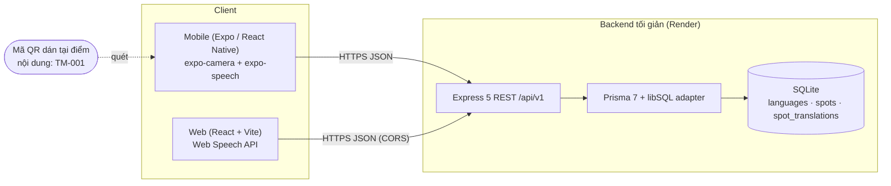

# Kiến trúc hệ thống

## Tổng quan



**Luồng chính:** du khách quét QR → app lấy mã (`TM-001`) → `GET /spots/qr/TM-001?lang=ja` →
nhận `narration` + `ttsLocale` → TTS của thiết bị đọc thành tiếng.

## Cấu trúc repo (monorepo pnpm)

```
apps/api        Backend (Express + Prisma + SQLite)        - A
apps/mobile     React Native (Expo)                        - B
apps/web        React.js (Vite)                            - C
packages/i18n   Chữ giao diện vi/en/ja/ko                  - C
docs/           Tài liệu, biên bản họp
.github/        CI/CD, template PR/issue
```

## Các quyết định thiết kế

| Quyết định                                               | Lý do                                                                                         |
| -------------------------------------------------------- | --------------------------------------------------------------------------------------------- |
| Backend tối giản, chỉ đọc dữ liệu                        | Nhóm khác làm BE riêng; ta chỉ cần dữ liệu thật để FE chạy và demo                            |
| **Dịch sẵn một lần**, lưu trong bảng `spot_translations` | Không phụ thuộc API dịch/khóa API lúc demo; kết quả ổn định, miễn phí                         |
| **TTS ở thiết bị** (expo-speech, Web Speech API)         | Không cần server sinh giọng; chạy được cả khi mạng yếu sau khi đã tải nội dung                |
| SQLite + Prisma 7 (driver adapter libSQL)                | Không cần dựng máy chủ DB; chuyển sang PostgreSQL/Turso chỉ đổi adapter + `provider`          |
| Seed **idempotent** chạy mỗi lần khởi động               | Render free có đĩa tạm: DB mất khi restart, nên migrate + seed lại tự động để dữ liệu luôn có |
| Một ngôn ngữ thiếu bản dịch → **fallback tiếng Việt**    | FE luôn có nội dung để hiển thị; cờ `fallback: true` để FE báo cho người dùng                 |
| API chỉ `GET`, CORS theo whitelist + regex preview       | Bề mặt tấn công nhỏ; không lưu dữ liệu cá nhân                                                |
| Tiền tố `/api/v1`                                        | Có chỗ để nâng phiên bản nếu đổi contract                                                     |
| Lỗi thống nhất `{ error: { code, message } }`            | FE xử lý theo `code`, không phải đoán theo chuỗi                                              |

## Cố tình không làm

Microservices, API gateway, phân quyền phức tạp, sinh giọng và dịch ở server. Nếu cần chữ "tự động"
trong báo cáo thì thêm 1 nút gọi API dịch ở mức _Could_ (xem `docs/srs.md`).

## Giới hạn đã biết

- SQLite trên Render free **mất dữ liệu khi restart** (không sao: dữ liệu chỉ đọc và được seed lại).
  Nếu sau này cần thêm/sửa điểm từ giao diện admin, chuyển sang PostgreSQL (Supabase/Neon).
- Free tier "ngủ" sau ~15 phút không dùng; xem `docs/demo-checklist.md` để chuẩn bị trước demo.
- Chất lượng giọng đọc phụ thuộc thiết bị/trình duyệt (xem mục TTS trong `docs/api-contract.md`).
