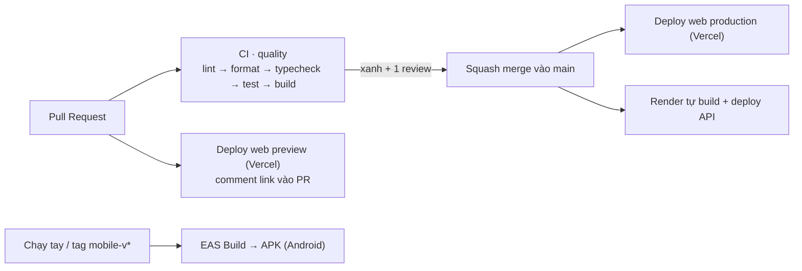

# CI/CD

| Workflow / cấu hình                | Khi nào chạy                        | Làm gì                                                                                                   |
| ---------------------------------- | ----------------------------------- | -------------------------------------------------------------------------------------------------------- |
| `.github/workflows/ci.yml`         | Mọi PR, push vào `main`             | `pnpm install --frozen-lockfile` → lint → format:check → typecheck → test → build (+ audit chỉ cảnh báo) |
| `.github/workflows/deploy-web.yml` | PR/push đụng `apps/web`, `packages` | PR: deploy **preview** + comment link. `main`: deploy **production**                                     |
| `.github/workflows/eas-build.yml`  | Chạy tay hoặc tag `mobile-v*`       | Build APK bằng EAS, ghi link tải vào _Job summary_                                                       |
| `render.yaml`                      | Push vào `main`                     | Render build + chạy `migrate deploy` + seed + start API                                                  |

## Cách CI hoạt động

- Dùng `--frozen-lockfile`: lockfile phải khớp `package.json`, tránh "máy tôi chạy được mà CI thì không".
- `pnpm -r --if-present`: package nào có script `typecheck/test/build` mới chạy, nên B và C thêm script vào
  package của mình là CI tự áp dụng, không cần sửa workflow.
- `concurrency` hủy lượt chạy cũ của cùng nhánh để tiết kiệm phút miễn phí.
- Cache pnpm qua `actions/setup-node`.
- Test backend dùng DB SQLite tạm + **migration thật + seed thật**, không cần dịch vụ ngoài nên CI chạy ổn định.

## Branch protection (nhánh `main`)

Thiết lập bằng `scripts/setup-github.sh` (hoặc Settings → Branches):

- Bắt buộc PR, **≥ 1 review**, dismiss review cũ khi có commit mới
- Bắt buộc check **`quality`** xanh và nhánh phải cập nhật với `main`
- Cấm force-push, cấm xóa, lịch sử tuyến tính (squash merge)
- Áp dụng cả cho admin (`enforce_admins`)

> Repo **private** trên tài khoản GitHub Free không có branch protection. Dùng repo public, hoặc đăng ký
> GitHub Student Developer Pack (miễn phí cho sinh viên) để có Pro.

## Secrets cần tạo (Settings → Secrets and variables → Actions)

| Secret              | Lấy ở đâu                                                  | Dùng cho       |
| ------------------- | ---------------------------------------------------------- | -------------- |
| `VERCEL_TOKEN`      | vercel.com → Account Settings → Tokens                     | deploy-web.yml |
| `VERCEL_ORG_ID`     | `apps/web/.vercel/project.json` sau khi chạy `vercel link` | deploy-web.yml |
| `VERCEL_PROJECT_ID` | như trên                                                   | deploy-web.yml |
| `EXPO_TOKEN`        | expo.dev → Account settings → Access tokens                | eas-build.yml  |

Không bao giờ commit token. Thiếu secret, workflow deploy-web tự bỏ qua (kèm ghi chú), eas-build báo lỗi rõ ràng.

## Xử lý sự cố thường gặp

| Triệu chứng                            | Cách xử lý                                                              |
| -------------------------------------- | ----------------------------------------------------------------------- |
| CI đỏ ở `format:check`                 | Chạy `pnpm format`, commit lại                                          |
| `ERR_PNPM_OUTDATED_LOCKFILE`           | Chạy `pnpm install` ở máy, commit `pnpm-lock.yaml`                      |
| Web preview bị chặn CORS               | Kiểm tra `CORS_ORIGIN_REGEX` trên Render có `^https://.*\.vercel\.app$` |
| EAS build lỗi "project not configured" | B chạy `eas init` trong `apps/mobile` và commit `app.json`              |
| Deploy-web bị chạy 2 lần               | Tắt Git integration của Vercel (đã có `git.deploymentEnabled=false`)    |
