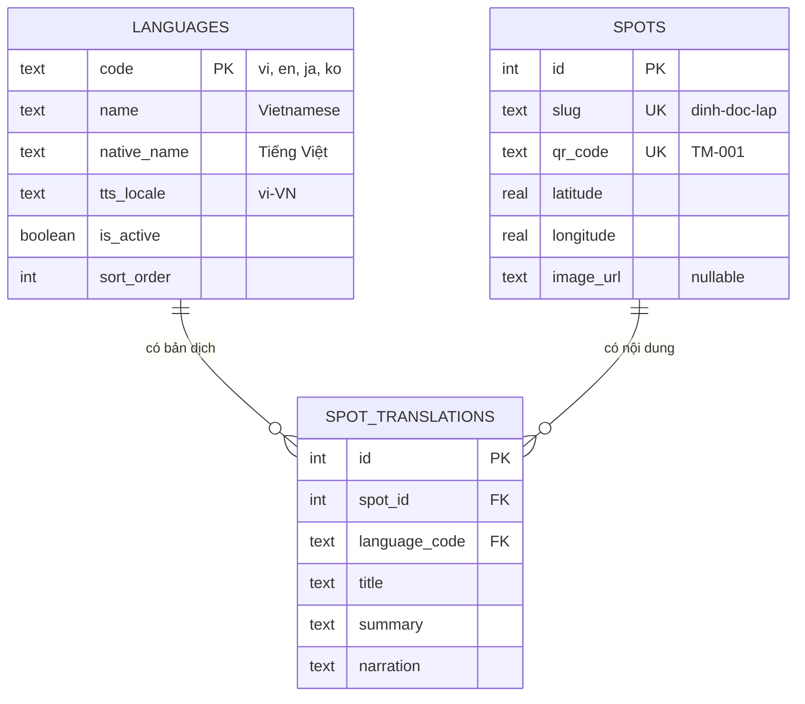

# ERD và từ điển dữ liệu

Ba bảng: `languages`, `spots`, `spot_translations`. Định nghĩa gốc: `apps/api/prisma/schema.prisma`.

## Từ điển dữ liệu

### `languages`

| Cột           | Kiểu    | Ghi chú                                                                  |
| ------------- | ------- | ------------------------------------------------------------------------ |
| `code` (PK)   | text    | Mã ngắn dùng trong `?lang=`                                              |
| `name`        | text    | Tên tiếng Anh                                                            |
| `native_name` | text    | Tên hiển thị trong màn hình chọn ngôn ngữ                                |
| `tts_locale`  | text    | Locale truyền cho TTS (`expo-speech`: `language`, Web: `utterance.lang`) |
| `is_active`   | boolean | `false` = ẩn khỏi API mà không cần xóa dữ liệu                           |
| `sort_order`  | int     | Thứ tự hiển thị                                                          |

### `spots`

| Cột                  | Kiểu | Ghi chú                                                        |
| -------------------- | ---- | -------------------------------------------------------------- |
| `id` (PK)            | int  | Tự tăng                                                        |
| `slug` (unique)      | text | Dùng trong URL, ổn định, không dấu                             |
| `qr_code` (unique)   | text | **Chính là nội dung mã QR** dán tại điểm (`TM-001` … `TM-006`) |
| `latitude/longitude` | real | Dùng cho tính năng tự phát khi đến gần (GPS, tuần 8–9)         |
| `image_url`          | text | Có thể null; FE dùng ảnh mặc định khi null                     |

### `spot_translations`

| Cột                    | Kiểu | Ghi chú                                        |
| ---------------------- | ---- | ---------------------------------------------- |
| `id` (PK)              | int  |                                                |
| `spot_id` (FK → spots) | int  | Xóa điểm thì xóa luôn các bản dịch (`CASCADE`) |
| `language_code` (FK)   | text | Không cho xóa ngôn ngữ đang được dùng          |
| `title`                | text | Tên điểm theo ngôn ngữ                         |
| `summary`              | text | 1 câu mô tả ngắn cho danh sách                 |
| `narration`            | text | Bài thuyết minh đầy đủ, đưa thẳng vào TTS      |

Ràng buộc: `UNIQUE(spot_id, language_code)`, mỗi điểm chỉ có 1 bản dịch cho mỗi ngôn ngữ.

## Thêm dữ liệu

- **Thêm ngôn ngữ mới:** thêm 1 dòng vào `languages` và các dòng `spot_translations` tương ứng
  (sửa `apps/api/src/seedData.ts`, chạy lại seed). Thiếu bản dịch cho điểm nào thì API tự fallback tiếng Việt.
- **Thêm điểm mới:** thêm 1 phần tử vào mảng `spots` trong `seedData.ts` với mã QR mới (`TM-007`…).

## Quy ước migration

- Mọi thay đổi schema đi kèm 1 migration mới (`pnpm --filter @tm/api db:migrate`), commit cả thư mục migration.
- Test (`src/__tests__/testApp.ts`) áp dụng **đúng các file migration thật** lên DB tạm, nên migration hỏng sẽ làm CI đỏ.
